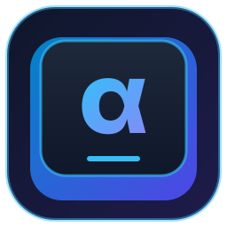

<div align="center">
  
  <h1>TypingAlpha</h1>
  <p><strong>Free, Offline & Open-Source English Touch-Typing Learning Software for Windows</strong></p>
</div>

---

## Overview

**TypingAlpha** is a 100% free, offline-capable desktop application for Windows designed to take complete beginners from hunting-and-pecking to confident **45–60+ WPM touch-typing** without subscriptions, paywalls, or ads.

Built with **Electron, React, TypeScript, and Vite**, it combines a **Day-by-Day Guided Learning Calendar**, a **24-Lesson Progressive Touch-Typing Course**, a **Keybr-style Adaptive Weak-Key Generator**, **Monkeytype-style Speed & N-Gram Tests**, **Interactive Visual Keyboard & Hand Guides**, and **Web Audio Mechanical Switch Synthesis**.

---

## Key Features

- **📅 Guided Learning Calendar (`14-Day`, `30-Day`, & `60-Day` Study Tracks)**:
  - Each day features a **3-Step Guided Daily Workout** (*Step 1: New Key Lesson* → *Step 2: Adaptive Weak-Key Drill* → *Step 3: Daily Fluency Check*).
  - **Beginner-Safe Cumulative Key Lock**: Every task on Day $X$ strictly uses **only** the keys you have learned from Day 1 up to Day $X$ (e.g., Day 1 only uses `F`, `J`, and `Space`).
  - Includes both a **Day-by-Day Roadmap Grid** and a **Real-Date Monthly Activity Calendar**.
- **🎓 6-Module, 24-Lesson Touch-Typing Course**:
  - Step-by-step mastery from **Home Row** (`A S D F G H J K L ;`) → **Top Row** (`Q W E R T Y U I O P`) → **Bottom Row** (`Z X C V B N M , . /`) → **Opposite-Hand `Shift` Capitals** → **Numbers & Symbols** → **N-Gram Speed & Paragraph Fluency**.
- **🧠 Adaptive Weak-Key Practice (Keybr-Style)**:
  - Dynamically generates pronounceable and real English words weighted toward your slowest or most error-prone keys, automatically unlocking new letters as your confidence reaches $\ge 80\%$.
- **⚡ Speed & N-Gram Tests (Monkeytype-Style)**:
  - Timed (`15s`, `30s`, `60s`, `120s`) and Word Count (`15`, `25`, `50`, `100`) modes across `English 200`, `English 1000`, `Top Bigrams`, `Top Trigrams`, and `Alternating Hands` pools.
- **📚 Quotes, Literature & Code Snippets**:
  - Practice real-world punctuation with famous quotes and book excerpts, or type programming syntax in **Python**, **TypeScript**, **C++**, and **Rust**.
- **🖐️ Visual & Audio Learning Aids**:
  - **Interactive On-Screen Keyboard** (`US QWERTY`, `UK QWERTY`, `Dvorak`, `Colemak`) with color-coded finger zones and opposite-hand `Shift` highlighting.
  - **Dual-Hand SVG Finger Guide** showing the exact finger and thumb to use for every character.
  - **Zero-Dependency Mechanical Switch Audio Synthesizer** (`Cherry MX Blue`, `MX Brown`, `MX Red`, `Vintage Typewriter`).
- **💾 Permanent Offline Windows Storage**:
  - Automatically saves all progress to `%APPDATA%\typing-alpha\user-progress.json` and `localStorage`, with 1-click `.json` Export/Import backup.

---

## Documentation Guides (`docs/`)

All detailed user and developer guides are located in the [`docs/`](./docs/) folder:

1. **[Getting Started & Ergonomics Guide](./docs/guide_getting_started.md)** — Installing the Windows `.exe`, setting up Home Row posture (`F & J`), and keyboard shortcuts.
2. **[Learning Calendar & Study Tracks Guide](./docs/guide_learning_calendar.md)** — How the 14/30/60-Day tracks, 3-step daily playlists, and beginner-safe cumulative key progression work.
3. **[Training Modes, Visual Aids & Customization Guide](./docs/guide_training_modes.md)** — Complete walkthrough of the Course, Adaptive Mode, Speed Tests, Quotes/Code, Custom Text Studio, Themes, and Audio profiles.
4. **[Offline Data Persistence, Privacy & Backup Guide](./docs/guide_data_and_privacy.md)** — Where `%APPDATA%` saves your progress and how to export/import `.json` backups.
5. **[Build, Testing & Windows `.exe` Packaging Guide](./docs/guide_build_and_packaging.md)** — Architecture overview, running Vitest unit tests, generating custom icons, and packaging Windows `.exe` installers.

---

## Installing or Running TypingAlpha on Windows

### 1. Pre-Built Windows Executables (`release/`)
- **Windows Setup Installer**: Run [`release/TypingAlpha-Setup-1.0.0.exe`](./release/TypingAlpha-Setup-1.0.0.exe) to install TypingAlpha with Desktop and Start Menu shortcuts.
- **Standalone Portable App**: Run [`release/TypingAlpha-Portable-1.0.0.exe`](./release/TypingAlpha-Portable-1.0.0.exe) directly with zero installation.
- **One-Click Batch Launcher**: Double-click [`Start-TypingAlpha.bat`](./Start-TypingAlpha.bat) in the project root.

### 2. Building from Source

```powershell
# Install dependencies
npm install

# Run automated unit tests (Vitest)
npm test

# Start in development mode (Vite + Electron)
npm run electron:dev

# Build production web bundle and launch Electron
npm run build
npm run electron:start

# Generate custom app icons and build Windows Setup & Portable .exe files
npm run electron:dist
```

---

## License

Free and Open-Source Software (MIT License). Built for learners everywhere.
